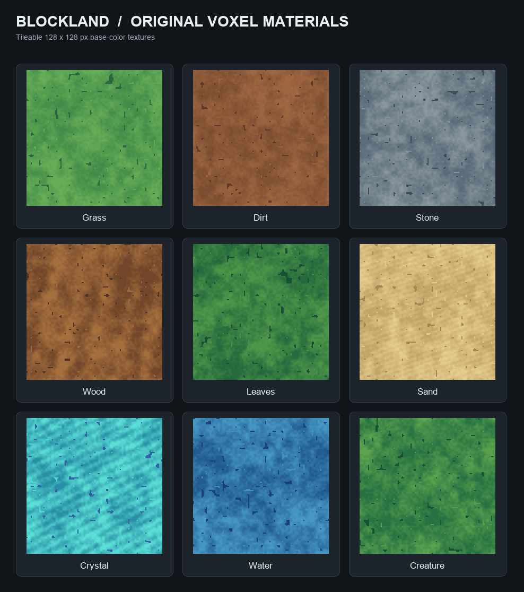

# Blockland

**Original first-person voxel game project for Unreal Engine 5.4+.**

[Italiano](#italiano) · [English](#english)

## Italiano

Blockland è un progetto di gioco voxel originale, scritto in C++ per Unreal
Engine. Genera un mondo procedurale a chunk e include esplorazione, raccolta e
posa dei blocchi, inventario, creature e salvataggi locali.

### Funzionalità

- Mondo procedurale con terreno, alberi, spiagge, acqua e cristalli.
- Texture tileable originali e normal map, importate e trasformate in materiali
  dall'Editor Unreal.
- Illuminazione atmosferica, ciclo giorno/notte e foschia.
- Movimento in prima persona, scavo, costruzione, hotbar e inventario.
- Creature ostili, combattimento, salute e schivata.
- Salvataggio locale di seed, posizione, inventario e modifiche al mondo.

### Requisiti

- Unreal Engine 5.4 o successivo.
- Visual Studio 2022 con il carico di lavoro **Sviluppo di giochi con C++** e
  i componenti per Unreal Engine.

### Avvio

1. Clona o scarica il repository.
2. Apri `Blockland.uproject` con Unreal Engine e consenti la compilazione del
   modulo C++.
3. Lascia attivi i plugin `PythonScriptPlugin` ed `EditorScriptingUtilities`,
   inclusi nella configurazione del progetto.
4. L'Editor importa le texture da `Tools/SourceTextures` e crea i materiali in
   `Content/Blockland/Materials`. Se l'importazione automatica non parte, usa
   **File > Execute Python Script** e seleziona
   `Content/Python/init_unreal.py`.
5. Premi **Play** per avviare il mondo.

Per rigenerare le texture, esegui `python Tools/generate_textures.py`.

### Comandi

| Tasto | Azione |
| --- | --- |
| WASD | Muovi il personaggio |
| Mouse | Guarda intorno |
| Spazio | Salta |
| Shift | Schivata |
| Clic sinistro | Scava |
| Clic destro | Posa un blocco |
| F | Attacca |
| I | Apri o chiudi l'inventario |
| 1-5 / rotellina | Seleziona un blocco |
| N | Crea un nuovo mondo |

### Texture e immagini

L'immagine in alto mostra le texture originali **Base Color** incluse nel
repository; le corrispondenti normal map sono disponibili in
`Tools/SourceTextures`. È un'anteprima delle texture, non uno screenshot del
gioco.

### Struttura del progetto

- `Source/Blockland/` — codice C++ del gioco.
- `Content/Python/` — importazione delle texture e creazione dei materiali.
- `Tools/SourceTextures/` — texture sorgente e normal map.
- `Tools/generate_textures.py` — generatore deterministico delle texture.
- `Config/` — impostazioni di avvio, render e controlli.
- `index.html` — vecchio prototipo web, non necessario per il progetto Unreal.

### Stato

Il repository contiene sorgenti e risorse originali. La compilazione C++ e il
test del gameplay devono essere eseguiti con Unreal Engine installato; non sono
stati verificati nell'ambiente che ha preparato questo repository.

## English

Blockland is an original voxel game project written in C++ for Unreal Engine.
It generates a procedural chunk-based world and includes exploration, block
mining and placement, inventory, creatures, and local saves.

### Features

- Procedural world with terrain, trees, beaches, water, and crystals.
- Original tileable textures and normal maps, imported and turned into
  materials by the Unreal Editor.
- Atmospheric lighting, day/night cycle, and distance fog.
- First-person movement, mining, building, hotbar, and inventory.
- Hostile creatures, combat, health, and dodge movement.
- Local saves for the seed, player position, inventory, and world edits.

### Requirements

- Unreal Engine 5.4 or newer.
- Visual Studio 2022 with the **Game development with C++** workload and Unreal
  Engine components.

### Getting started

1. Clone or download this repository.
2. Open `Blockland.uproject` in Unreal Engine and allow the C++ module to build.
3. Keep `PythonScriptPlugin` and `EditorScriptingUtilities` enabled; they are
   included in the project configuration.
4. The Editor imports textures from `Tools/SourceTextures` and creates
   materials in `Content/Blockland/Materials`. If automatic import does not
   run, use **File > Execute Python Script** and select
   `Content/Python/init_unreal.py`.
5. Press **Play** to start the world.

To regenerate the textures, run `python Tools/generate_textures.py`.

### Controls

| Key | Action |
| --- | --- |
| WASD | Move |
| Mouse | Look around |
| Space | Jump |
| Shift | Dodge |
| Left mouse button | Mine |
| Right mouse button | Place a block |
| F | Attack |
| I | Open or close inventory |
| 1-5 / mouse wheel | Select a block |
| N | Create a new world |

### Textures and images

The image above previews the original **Base Color** textures included in this
repository; matching normal maps are available in `Tools/SourceTextures`. It is
a texture preview, not a gameplay screenshot.

### Project layout

- `Source/Blockland/` — C++ game code.
- `Content/Python/` — texture import and material creation.
- `Tools/SourceTextures/` — source textures and normal maps.
- `Tools/generate_textures.py` — deterministic texture generator.
- `Config/` — startup, rendering, and input settings.
- `index.html` — legacy web prototype; not required for the Unreal project.

### Status

This repository contains the original source code and assets. C++ compilation
and gameplay testing must be performed with Unreal Engine installed; they have
not been verified in the environment used to prepare this repository.
